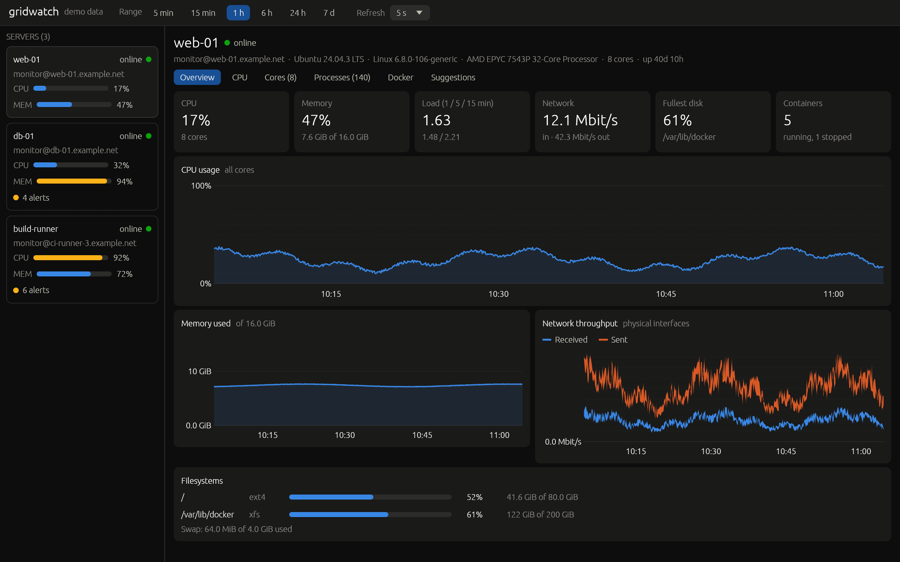
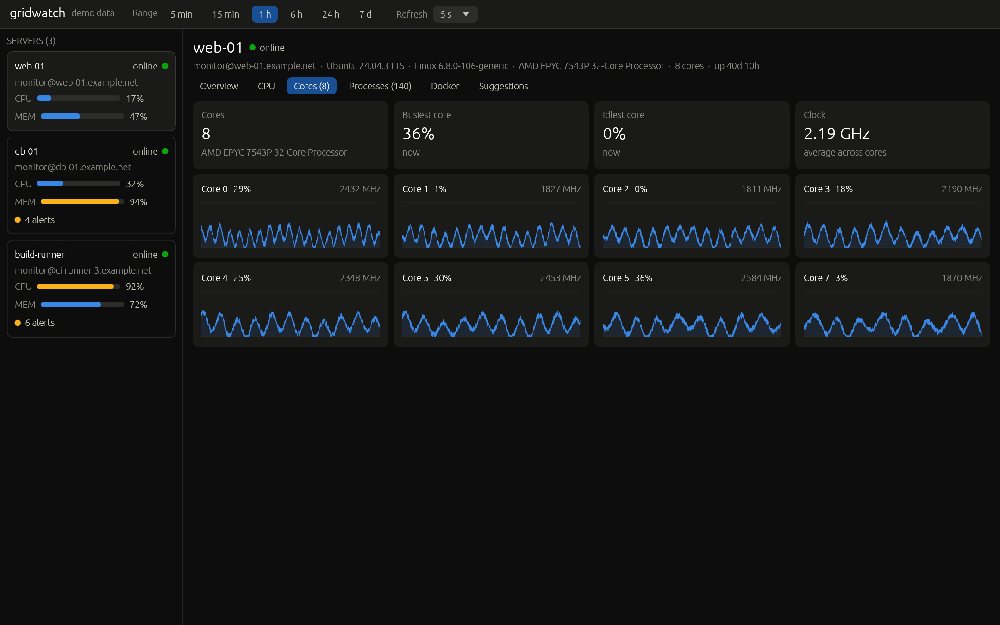
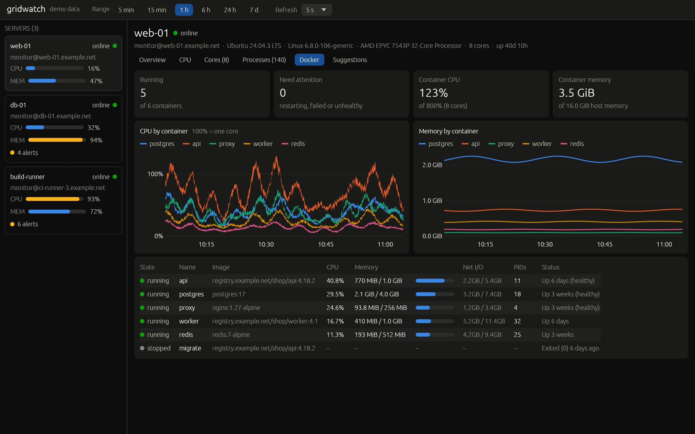

# gridwatch

A desktop dashboard for Windows, Linux and macOS that watches Linux servers over SSH.
Nothing is installed on the monitored machines: gridwatch logs in, reads `/proc`, `df`, `ps`
and the docker CLI, and draws the result.



## Features

- **Several servers at once** - every server has its own connection and reconnects on its own;
  the sidebar shows state, CPU, memory and the number of open alerts for each.
- **Tabs per server**
  - **Overview** - CPU, memory, load, network, disks and containers at a glance
  - **CPU** - time split into user / system / I/O wait / steal, load average, temperature
  - **Cores** - one chart per core, plus clock frequency
  - **Processes** - live CPU per process (measured between two polls, not the lifetime average `ps` prints), filter and sort
  - **Docker** - state, CPU, memory, limits and network I/O of every container, with charts for the heaviest ones
  - **Suggestions** - plain-language findings with a concrete next step
- **History saved locally** in SQLite. Charts cover 5 minutes to 7 days and survive a restart;
  data older than 14 days is pruned.
- **Suggestions** for saturated CPU, load above core count, I/O wait, CPU steal, memory and swap
  pressure, full disks, high temperature, zombie processes, pending reboots, containers that
  restart, fail, are unhealthy, run without or close to their memory limit, and more.

| CPU | Cores |
| --- | --- |
|  |  |

| Processes | Docker |
| --- | --- |
|  |  |


The screenshots show the built-in demo data (`gridwatch --demo`).

## Build and run

Requires a recent Rust toolchain (edition 2024) and a C compiler (for the bundled SQLite and `ring`).

```sh
cargo run --release
```

On Linux the usual desktop libraries for a windowed app are needed, e.g. on Debian/Ubuntu:
`sudo apt install build-essential libxkbcommon-dev libwayland-dev`.

Try it without any server:

```sh
cargo run --release -- --demo
```

| Option | Effect |
| --- | --- |
| `--demo` | simulated servers; nothing is read from or written to disk |
| `--screenshot <DIR>` | save a PNG of every tab into `DIR`, then exit |
| `--delay <SECONDS>` | wait for data before the first screenshot |

## Adding a server

Click **+ Add server** and enter the host (or `user@host`). Three ways to authenticate:

| Method | What happens |
| --- | --- |
| SSH agent / default keys | tries the running SSH agent, then `~/.ssh/id_ed25519`, `id_ecdsa`, `id_rsa` |
| Key file | a specific private key; the passphrase is asked for if the key is encrypted |
| Password | asked for on connect |

Passwords and passphrases are kept in memory only and are never written to disk, so they have to
be entered again after a restart. Key or agent authentication avoids that.

**Host keys** are checked against `~/.ssh/known_hosts` first. A host that is not known yet is
trusted on first use and recorded in gridwatch's own `known_hosts` file. If a host key ever
changes, gridwatch refuses to connect.

The remote user needs no special rights. To see containers it must be allowed to run `docker`
(member of the `docker` group).

## Where data is stored

| | Windows | Linux | macOS |
| --- | --- | --- | --- |
| Config (`config.json`) | `%APPDATA%\gridwatch\config` | `~/.config/gridwatch` | `~/Library/Application Support/gridwatch` |
| History (`history.sqlite`), `known_hosts` | `%APPDATA%\gridwatch\data` | `~/.local/share/gridwatch` | `~/Library/Application Support/gridwatch` |

## Requirements on the monitored machine

Linux with `/proc`, a POSIX `sh`, `df` and procps `ps`. Per-core frequency and temperature
are shown when the kernel exposes them (`/proc/cpuinfo`, `/sys/class/thermal`).

## Development

```sh
cargo test      # parsers, history store, suggestion rules
cargo run -- --demo --screenshot docs/screenshots --delay 2   # regenerate the screenshots
```

| File | Purpose |
| --- | --- |
| `src/ssh.rs` | connection, host key check, authentication (russh) |
| `src/parse.rs` | the remote scripts and the parsers for their output |
| `src/collector.rs` | one polling task per server |
| `src/store.rs` | SQLite history and the config file |
| `src/suggest.rs` | suggestion rules |
| `src/app.rs`, `src/widgets.rs` | the egui user interface |
| `src/demo.rs` | simulated servers |
