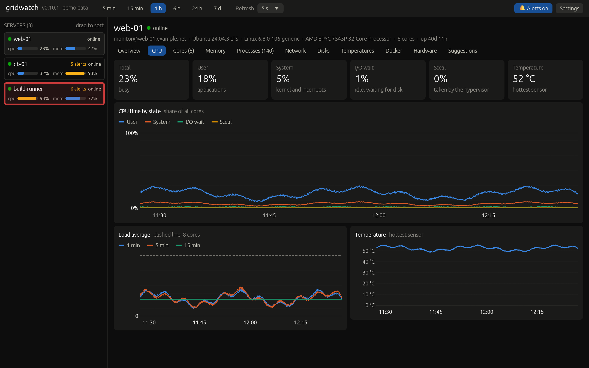
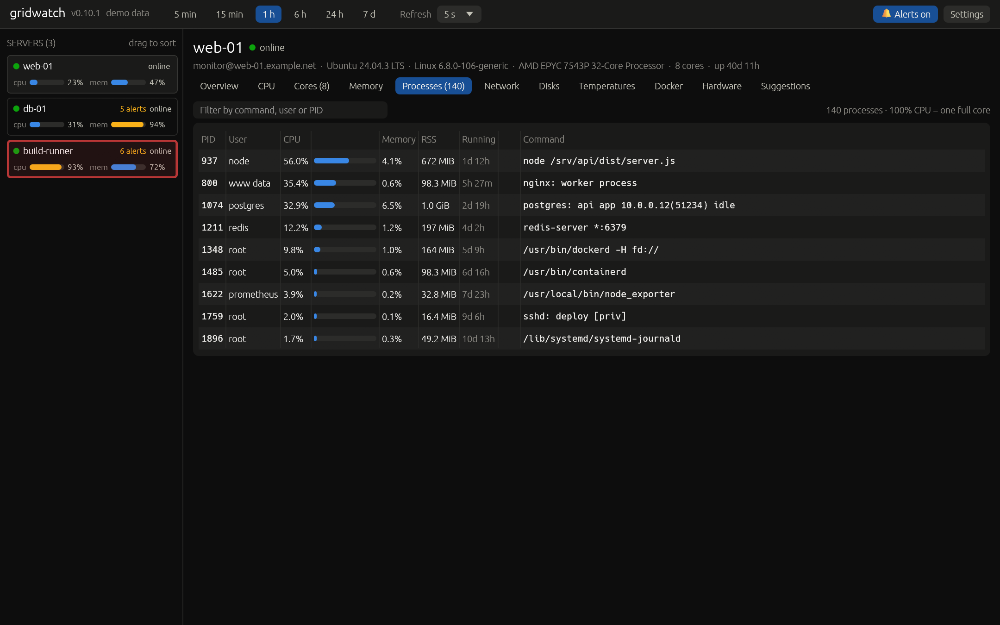
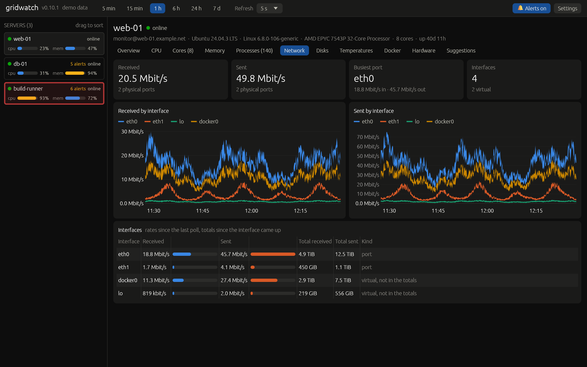
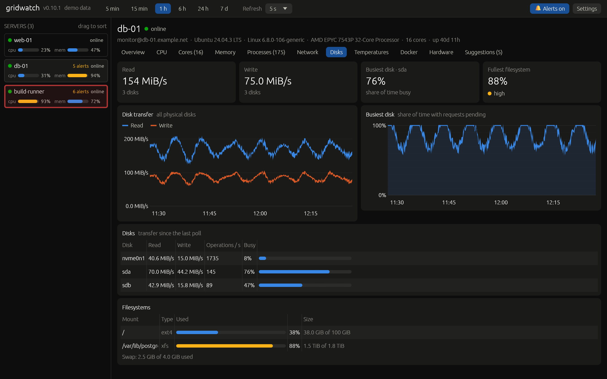
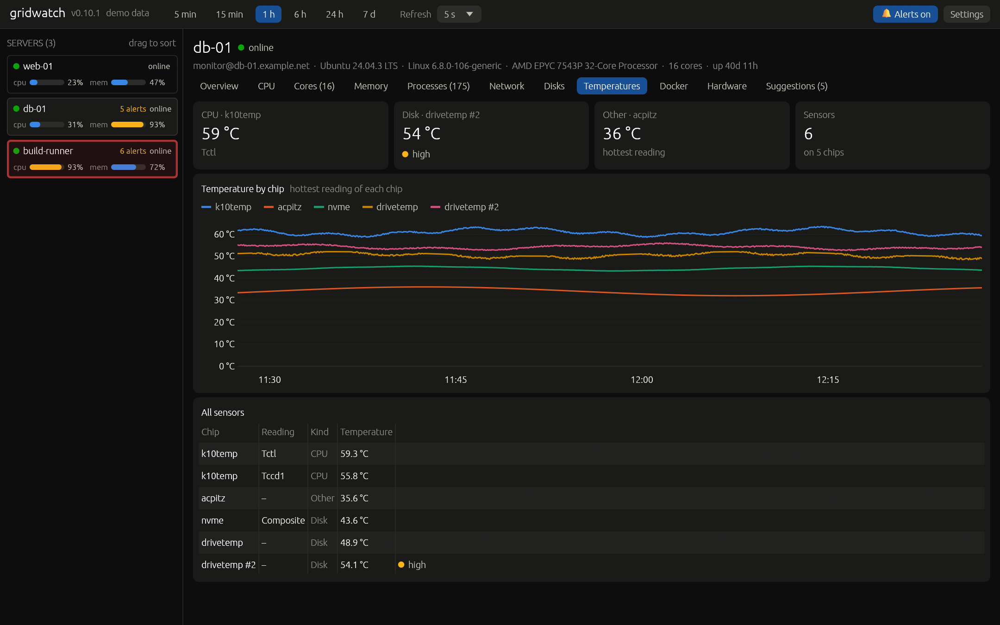
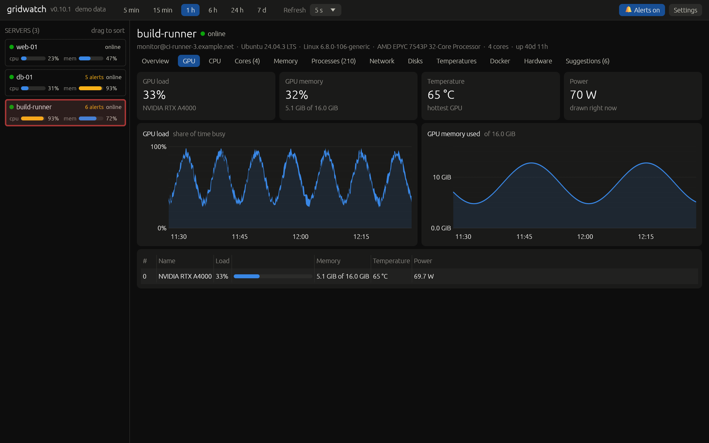
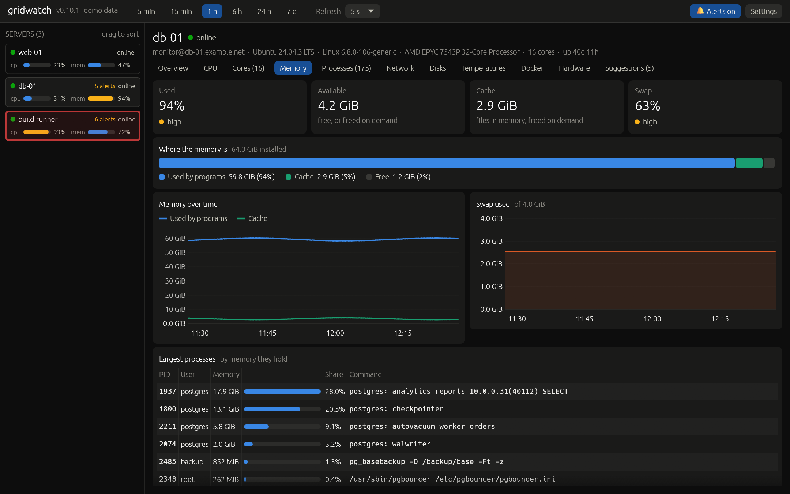
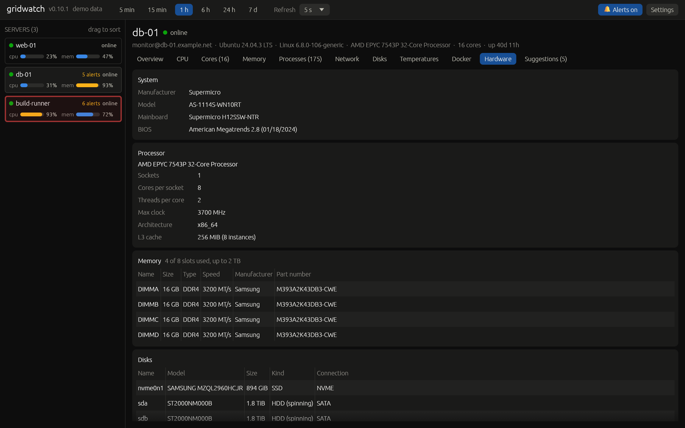
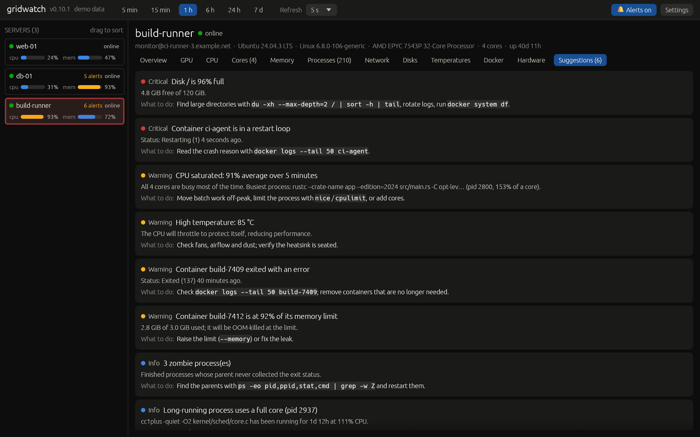
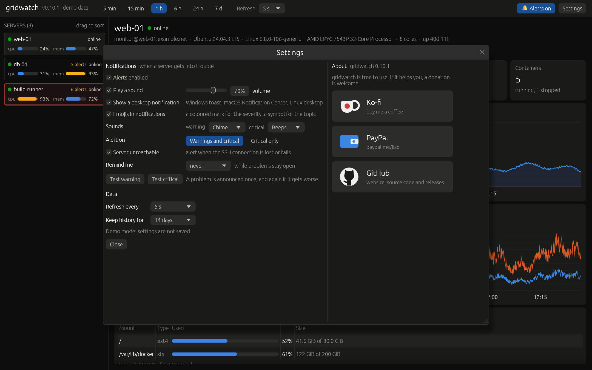

# gridwatch

A desktop dashboard for Windows, Linux and macOS that watches Linux and macOS machines over SSH,
and the computer it runs on. Nothing is installed on the monitored machines: gridwatch logs in,
reads `/proc` (or `sysctl` and `vm_stat` on a Mac), `df`, `ps` and the docker CLI, and draws the result.


## Features

- **Several servers at once** - every server has its own connection and reconnects on its own;
  the sidebar shows state, CPU, memory and the number of open alerts for each. Drag a server to
  change the order.
- **This computer** is the first entry, without any connection. On Windows the default WSL
  distribution can be listed too.
- **Tabs per server**
  - **Overview** - CPU, memory, load, network, disks and containers at a glance
  - **CPU** - time split into user / system / I/O wait / steal, load average, temperature
  - **Cores** - one chart per core, plus clock frequency
  - **Memory** - programs, cache and free over time, swap, the largest processes
  - **Processes** - live CPU per process (measured between two polls, not the lifetime average `ps` prints), filter and sort
  - **Network** - received and sent traffic per interface, with totals since the interface came up
  - **Disks** - read and write transfer per disk, operations per second, share of time busy, filesystems
  - **Temperatures** - every sensor: CPU, GPU, NVMe and SATA disks, mainboard
  - **GPU** - load, memory, temperature and power (only on machines that have one)
  - **Docker** - state, CPU, memory, limits and network I/O of every container, with charts for the heaviest ones
  - **Hardware** - what is built into the machine: mainboard, processor, memory modules, disks, graphics, network adapters
  - **Suggestions** - plain-language findings with a concrete next step
- **History saved locally** in SQLite. Charts cover 5 minutes to 7 days and survive a restart;
  data older than 14 days is pruned.
- **Suggestions** for saturated CPU, load above core count, I/O wait, CPU steal, memory and swap
  pressure, full or saturated disks, hot CPUs, disks and GPUs, zombie processes, pending reboots,
  containers that restart, fail, are unhealthy, run without or close to their memory limit, and more.
- A **red frame** around a server in the list when a critical problem newly arrives, fading out slowly.
- **Tray icon** on Windows and macOS - shows the worst state of all servers; closing the window
  keeps gridwatch running there, so alerts keep coming.
- **Alerts** - a sound and a desktop notification (Windows, macOS, Linux) when a server gets into
  trouble or cannot be reached. One click on the bell in the top bar switches them off and on.

| CPU | Cores |
| --- | --- |
|  |  |

| Processes | Network |
| --- | --- |
|  |  |

| Disks | Temperatures |
| --- | --- |
|  |  |

| GPU | Docker |
| --- | --- |
|  |  |

| Memory | Hardware |
| --- | --- |
|  |  |



The screenshots show the built-in demo data (`gridwatch --demo`).

## Alerts and settings



A problem is announced once when it appears, and again only if it gets worse; a value that hovers
around its threshold does not ring every few seconds. Alerts also arrive while the window is
minimised. The **Alerts on / off** button in the top bar is the master switch. **Settings** has the rest:

| Setting | Effect |
| --- | --- |
| Play a sound, volume | a two-note chime for warnings, three beeps for critical problems |
| Show a desktop notification | names the server and the new problems |
| Alert on | warnings and critical problems, or critical only |
| Server unreachable | alert when the SSH connection is lost or cannot be made |
| Remind me | repeat the alert every 5 to 60 minutes while problems stay open |
| Refresh every, Keep history for | poll interval and how long history stays in the database |
| Show this computer | list the computer gridwatch runs on |
| Start, stop and restart docker containers | adds the buttons to the Docker tab; off by default. The login user must be allowed to run docker |
| End processes | adds an End button to the Processes tab; off by default. An ordinary user can only end its own processes, others need a root login |
| Keep running in the tray | closing the window hides it in the tray; *Quit* is in the menu of the tray icon |
| Show its Linux (WSL) | Windows only: list the default WSL distribution. Watching it keeps WSL running |
| Save passwords in the system keychain | see below |

On Windows the notification is shown under the name of Windows PowerShell, because gridwatch
has no installer that could register its own name. On macOS it appears under Finder for the same reason.

## Download

Every version is built by GitHub Actions and published on the **Releases** page of the repository.

| System | Download | Then |
| --- | --- | --- |
| Windows | `gridwatch-v...-windows-x86_64-setup.exe` | run it; gridwatch is installed for your user, no administrator rights needed |
| macOS, Apple Silicon | `gridwatch-v...-macos-arm64.dmg` | open it and drag gridwatch to Applications |
| macOS, Intel | `gridwatch-v...-macos-x86_64.dmg` | the same |
| Linux | `gridwatch-v...-linux-x86_64.tar.gz` | unpack and start `gridwatch` |

The `.zip` and `.tar.gz` archives next to the installers are what the built-in updater downloads;
they also work as a portable version without installation.

Neither installer is signed with a paid developer certificate. Windows SmartScreen may ask for
confirmation (*More info*, *Run anyway*). On macOS the first start needs a right click and *Open*
(or, if macOS calls the app damaged, `xattr -dr com.apple.quarantine /Applications/gridwatch.app`
in a terminal).

## Updates

gridwatch asks GitHub at start whether a newer version exists. If so, an **Update to ...** button
appears in the top bar; it shows what is new and, after a click on *Download and install*, fetches
the release, compares it with the checksum GitHub publishes, and replaces the program. Nothing is
installed without that click. The check can be switched off in the settings, and
`gridwatch --update` does the same from a terminal.

## Build and run

Requires a recent Rust toolchain (edition 2024) and a C compiler (for the bundled SQLite and `ring`).

```sh
cargo run --release
```

On Linux the usual desktop libraries for a windowed app are needed, e.g. on Debian/Ubuntu:
`sudo apt install build-essential pkg-config libxkbcommon-dev libwayland-dev libasound2-dev`.

Try it without any server:

```sh
cargo run --release -- --demo
```

| Option | Effect |
| --- | --- |
| `--demo` | simulated servers; nothing is read from or written to disk |
| `--screenshot <DIR>` | save a PNG of every tab into `DIR`, then exit |
| `--delay <SECONDS>` | wait for data before the first screenshot |
| `--update` | install the newest version, if there is one, and exit |
| `--version` | print the version |

## Adding a server

Click **+ Add server** and enter the host (or `user@host`). Three ways to authenticate:

| Method | What happens |
| --- | --- |
| SSH agent / default keys | tries the running SSH agent, then `~/.ssh/id_ed25519`, `id_ecdsa`, `id_rsa` |
| Key file | a specific private key; the passphrase is asked for if the key is encrypted |
| Password | asked for on connect |

**Passwords and passphrases** are never written to a file by gridwatch. With *Save passwords in
the system keychain* switched on (the default) they are handed to the keychain of the operating
system - Windows Credential Manager, macOS Keychain, or the Secret Service on Linux (GNOME Keyring,
KWallet) - and read from there at the next start. Switch it off and they are kept in memory only,
removed from the keychain, and asked for again after every restart. Removing a server removes its
entry.

macOS asks for permission when gridwatch reads its keychain item: once per start if you answer
*Allow*, not at all after *Always Allow* - until the next update, because gridwatch is not signed
by a registered developer and macOS then treats it as a new program.

**Host keys** are checked against `~/.ssh/known_hosts` first. A host that is not known yet is
trusted on first use and recorded in gridwatch's own `known_hosts` file. If a host key ever
changes, gridwatch refuses to connect.

The remote user needs no special rights. To see containers it must be allowed to run `docker`
(member of the `docker` group).

## Where data is stored

| | Windows | Linux | macOS |
| --- | --- | --- | --- |
| Config (`config.json`) | `%APPDATA%\gridwatch\config` | `~/.config/gridwatch` | `~/Library/Application Support/gridwatch` |
| History (`history.sqlite`), `known_hosts` | `%APPDATA%\gridwatch\data` | `~/.local/share/gridwatch` | `~/Library/Application Support/gridwatch` |

## What a machine has to offer

| | Linux | macOS | This computer on Windows |
| --- | --- | --- | --- |
| CPU, memory, processes, network, filesystems | `/proc`, `df`, procps `ps` | `sysctl`, `vm_stat`, `netstat`, `df`, `ps` | Windows API |
| Usage per core | yes | needs `python3` (Xcode command line tools or Homebrew) | yes |
| I/O wait, load average | yes | load only | no |
| Disk transfer | per disk, with busy time | per disk | per volume |
| Temperatures | `hwmon` and thermal zones; SATA disks need `sudo modprobe drivetemp` | needs `macmon` (`brew install macmon`) | no |
| GPU | `nvidia-smi`, `amdgpu` | `macmon` | `nvidia-smi` |
| Docker | `docker` CLI | `docker` in `/usr/local/bin` or `/opt/homebrew/bin` | `docker` CLI (Docker Desktop) |
| Hardware | `lscpu`, `lsblk`, `lspci`, `/sys`; memory modules need passwordless `sudo dmidecode` | `system_profiler` | PowerShell (CIM) |

A Mac needs Remote Login enabled (System Settings > General > Sharing). A POSIX `sh` is all that
is required of the login shell.

## Versions and releases

The version lives in `Cargo.toml`, is shown in the top bar, and is raised with every fix (last
number) or feature (middle number); [CHANGELOG.md](CHANGELOG.md) says what changed. To publish:

```sh
git tag v0.3.0 && git push origin v0.3.0
```

The `Release` workflow checks that the tag matches `Cargo.toml`, builds for Windows, Linux and
macOS (Apple Silicon and Intel) and attaches the archives to a GitHub release with the notes of
that version. The `CI` workflow builds and tests every push and pull request on all three systems.

## Support

gridwatch is free. If it saves you time, a donation is welcome:
[Ko-fi](https://ko-fi.com/A0A05OS1A) or [PayPal](https://paypal.me/lizo).

## License

gridwatch is free to use, change and pass on, by private people and by companies alike.
It may not be sold: neither gridwatch itself nor a changed version of it, and not as a paid
product, hosted service or support offering that gets its value from gridwatch. The exact terms
are in [LICENSE](LICENSE): the Apache License 2.0 with the Commons Clause condition. Because of
that condition it is "source available", not open source in the OSI sense. For a commercial
licence, ask the licensor.

## Development

```sh
cargo test      # parsers, history store, suggestion and alert rules
cargo run -- --demo --screenshot docs/screenshots --delay 2   # regenerate the screenshots

# tests that touch the real world, run on request
GRIDWATCH_TEST_HOST=user@host cargo test live_host -- --ignored --nocapture   # poll a machine over ssh
cargo test local_shell -- --ignored --nocapture                               # poll this computer (WSL on Windows)
cargo test keychain -- --ignored                                              # write to and read from the keychain
cargo test hear_and_see -- --ignored                                          # play two alert sounds and show a notification
cargo test real_release -- --ignored --nocapture                              # download the latest release and run it
```

| File | Purpose |
| --- | --- |
| `src/ssh.rs` | connection, host key check, authentication (russh) |
| `src/parse.rs` | the collection scripts and the parsers for their output |
| `src/hardware.rs` | the hardware inventory: scripts and parsers |
| `src/collector.rs` | one polling task per server: SSH, local shell, WSL |
| `src/local_windows.rs` | this computer on Windows, through the Windows API |
| `src/store.rs` | SQLite history and the config file |
| `src/secrets.rs` | passwords in the system keychain |
| `src/update.rs` | looking for and installing a newer release |
| `src/suggest.rs` | suggestion rules |
| `src/notify.rs` | alert sound and desktop notifications |
| `src/tray.rs` | the tray icon |
| `src/actions.rs` | start, stop and restart containers, end processes |
| `src/instance.rs` | one running copy: a second start wakes the first |
| `src/app.rs`, `src/widgets.rs` | the egui user interface |
| `src/demo.rs` | simulated servers |
| `packaging/` | the icon, the Inno Setup script for Windows, the app bundle and disk image for macOS |
